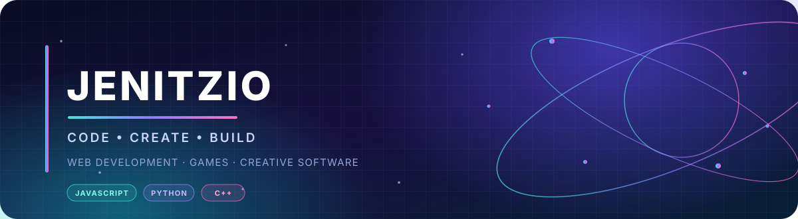

  

  
  
  

  

---

<h2 align="center">ABOUT ME</h2>

  Programmer working with JavaScript, Python, C++, Rust, and web technologies to build games, interactive software, and useful online experiences. I sometimes Vibe-Code to save time 😂 
  I develop <a href="https://jenitzio.co.uk"><strong>jenitzio.co.uk</strong></a> and a growing suite of free creative tools for photography, image editing, video, and music.

<h2 align="center">WHAT I BUILD</h2>

<table align="center">
  <tr>
    <td align="center" width="33%">
      <h3>Games</h3>
      Browser-based games, gameplay systems, and interactive experiments.
    </td>
    <td align="center" width="33%">
      <h3>Web & Systems</h3>
      Websites, web apps, APIs, servers, and connected services.
    </td>
    <td align="center" width="33%">
      <h3>Creative Tools</h3>
      Free tools for photo, image, video, and music workflows.
    </td>
  </tr>
</table>

<h2 align="center">COLLABORATIONS</h2>

  Working with <a href="https://github.com/centralorbit-org"><strong>DivineVibe (@centralorbit-org)</strong></a> on development projects and ideas.
   
  

<h2 align="center">CONNECT</h2>

  
  
  
  

---

<h2 align="center">TECH STACK</h2>

<h3 align="center">Languages</h3>

  
  
  
  
  
  
  
  
  

<h3 align="center">Web Development & Infrastructure</h3>

  
  
  
  
  
  
  
  
  
  

<h3 align="center">Graphics & Visual Computing</h3>

  
  
  
  
  
  

<h3 align="center">Creative & Data Tools</h3>

  
  
  
  
  
  

<h3 align="center">Development & Game Engines</h3>

  
  
  
  
  
  
  
  

---

<h2 align="center">GITHUB STATS</h2>

  
  

  

<h3 align="center">TOP CONTRIBUTED REPOSITORIES</h3>

  

---

  
    
  Thanks for stopping by — explore, connect, and build something great.

