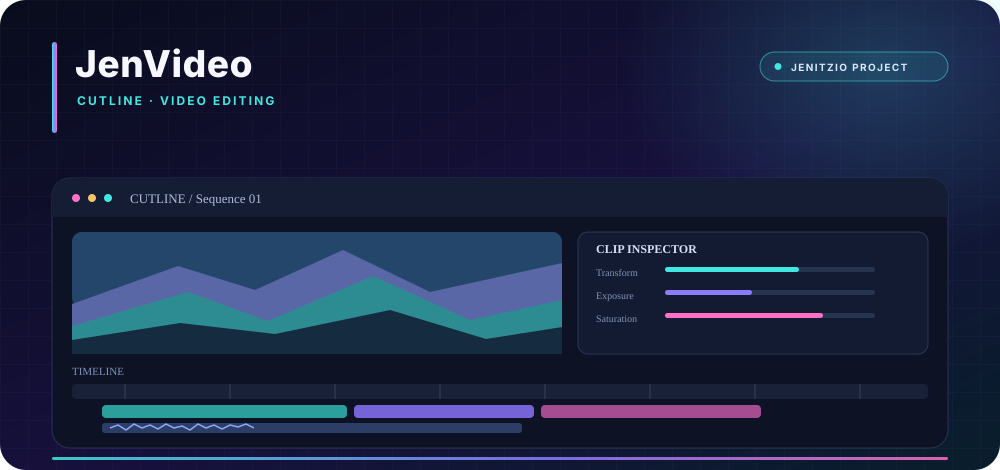
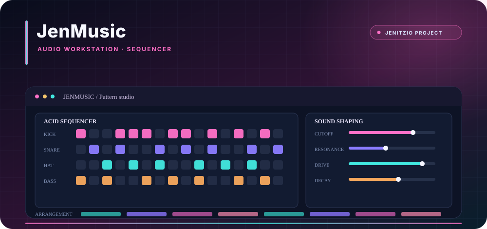
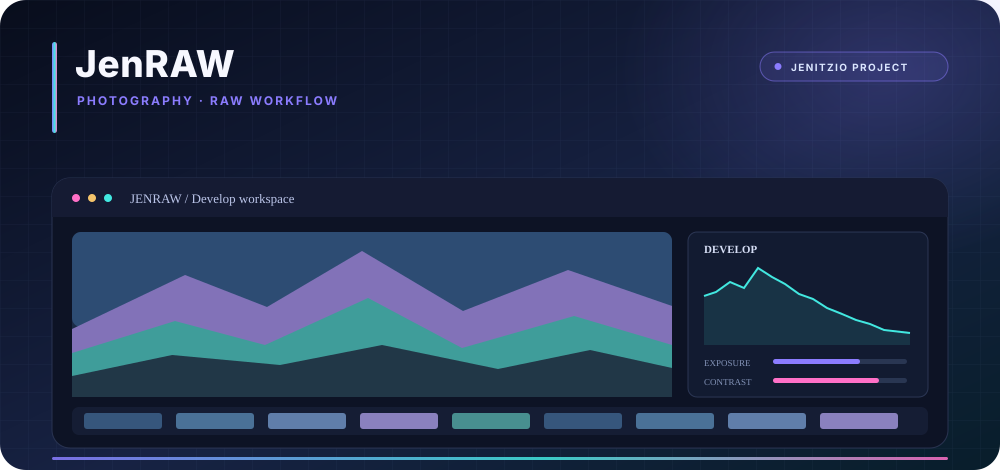
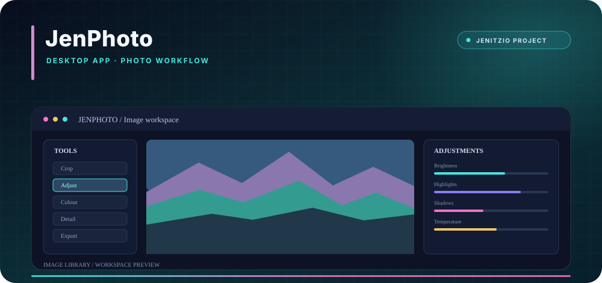
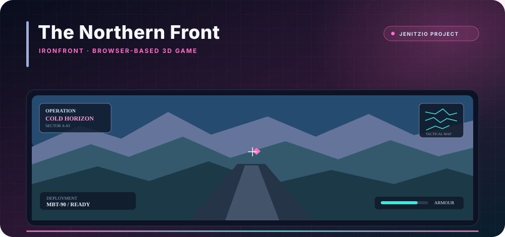
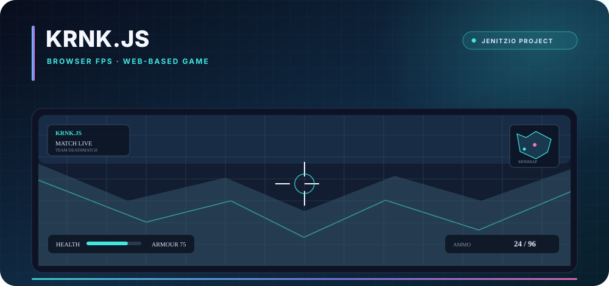

  

  
  
  

  

---

<h2 align="center">ABOUT</h2>

  I build the <a href="https://jenitzio.co.uk"><strong>Jenitzio websites</strong></a>: a growing collection of web applications, browser games, creative tools and experiments.
   
  My work spans interface design, interactive systems and desktop software, with a focus on making ambitious ideas useful, accessible and enjoyable to explore.

  
  
  

---

<h2 align="center">FEATURED PROJECTS</h2>

  A selection of projects across creative software, games and interactive applications.

<table>
  <tr>
    <td width="33%" valign="top">
      
      <h3 align="center">JenVideo</h3>
      
A browser-based video editor built around a timeline workspace, clip tools, visual adjustments and audio workflows.

      

      
<a href="https://github.com/jenitzio/JenVideo"><strong>View repository</strong></a>

    </td>
    <td width="33%" valign="top">
      
      <h3 align="center">JenMusic</h3>
      
A browser-based electronic music workstation with a drum machine, acid sequencer, audio timeline and desktop wrapper.

      

      
<a href="https://github.com/jenitzio/JenMusic"><strong>View repository</strong></a>

    </td>
    <td width="33%" valign="top">
      
      <h3 align="center">JenRAW</h3>
      
A desktop photography workflow for Canon files and common image formats, with image adjustments and a configurable workspace.

      

      
<a href="https://github.com/jenitzio/JenRAW"><strong>View repository</strong></a>

    </td>
  </tr>
  <tr>
    <td width="33%" valign="top">
      
      <h3 align="center">JenPhoto</h3>
      
A desktop app packaged with Electron, bringing a web-based photo workspace into a downloadable application.

      

      
<a href="https://github.com/jenitzio/JenPhoto"><strong>View repository</strong></a> · <a href="https://github.com/jenitzio/JenPhoto/releases">Releases</a>

    </td>
    <td width="33%" valign="top">
      
      <h3 align="center">The Northern Front</h3>
      
IRONFRONT is a browser-based 3D combined-arms game featuring vehicles, infantry, squad commands and capture-sector objectives.

      

      
<a href="https://github.com/jenitzio/The-Northern-Front"><strong>View repository</strong></a>

    </td>
    <td width="33%" valign="top">
      
      <h3 align="center">KRNK.JS</h3>
      
A browser FPS project built with web technologies, with a focus on responsive gameplay systems and multiplayer-oriented features.

      

      
<a href="https://github.com/jenitzio/KRNK.JS"><strong>View repository</strong></a>

    </td>
  </tr>
</table>

  The project visuals are original illustrations of each project's direction, not screenshots of a running build. Check each repository for current implementation details and status.

  

---

<h2 align="center">THE JENITZIO ECOSYSTEM</h2>

<table>
  <tr>
    <td width="33%" valign="top">
      <h3 align="center"><a href="https://jenitzio.co.uk">Web &amp; Systems</a></h3>
      
Websites, portals, APIs, connected services and experiments that bring projects together.

    </td>
    <td width="33%" valign="top">
      <h3 align="center">Games &amp; Interaction</h3>
      
Browser games, gameplay systems, interactive environments and experiments in real-time experiences.

    </td>
    <td width="33%" valign="top">
      <h3 align="center">Creative Software</h3>
      
Tools for photography, image editing, video and music workflows, built with a strong focus on interface and usability.

    </td>
  </tr>
</table>

  

---

<h2 align="center">TECHNOLOGIES</h2>

<h3 align="center">Languages</h3>

  
  
  
  
  
  
  
  

<h3 align="center">Web, Apps &amp; Graphics</h3>

  
  
  
  
  
  
  
  

---

<h2 align="center">GITHUB ACTIVITY</h2>

  
  

  Statistics and language estimates are generated by an external service and may not always be available or reflect every part of a project.

---

<h2 align="center">COLLABORATION &amp; CONTACT</h2>

  I collaborate with <a href="https://github.com/centralorbit-org"><strong>DivineVibe (@centralorbit-org)</strong></a> on development projects and ideas.

  
  
  

  
    
  Code with purpose. Create with curiosity. Build what comes next.

